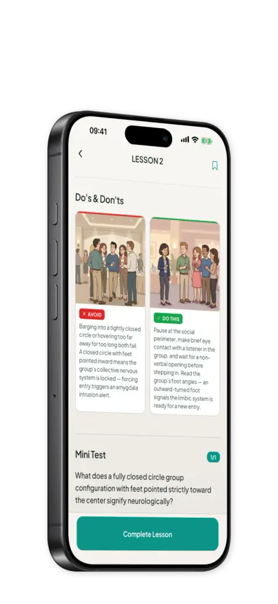

# Bodica

Bodica teaches you to read body language with short lessons and quizzes, and it can read the body language in a photo. It's on the App Store and Google Play in English, Spanish and Turkish. I built it alone and I still run it.

[App Store](https://apps.apple.com/app/id6756843038) · [Google Play](https://play.google.com/store/apps/details?id=com.anilburcu.readbody)

  
  
  

The code is private. These are the parts I'd want to read about in someone else's app.

## Apple made me ask before sending a photo to Gemini

Guideline 5.1.2(i) wants permission before personal data goes to a third-party AI. So before the first analysis, a sheet says the photo goes to Google's Gemini and that Bodica keeps only the written result. Without a yes, nothing is sent.

Ten days earlier I added "Report this result" under each analysis for guideline 1.2. The server copies the text from its own table, so nobody can report words the model never wrote.

## Two digests at once could crash Hermes

Supabase auth needs `crypto.subtle.digest`, and Hermes doesn't ship WebCrypto, so I polyfilled it with expo-crypto. Concurrent calls could then SIGSEGV in `JavaScriptTypedArray::~JavaScriptTypedArray`. A mutex around the digest stopped it. At this call volume it costs nothing.

## Anyone could have claimed someone else's subscription

An early version of `claim-subscription` believed what the client sent. If you knew someone's `original_transaction_id`, you could POST `{is_active: true}` and take their subscription. Client claims authorize nothing now. A transfer needs a conflict written by the RevenueCat webhook, or proof fetched on the server.

## I shipped 1,500 icons to use 97

Importing from the Phosphor package root pulled every icon into the bundle, about 5 MB of Hermes bytecode. All 14 Plus Jakarta font files came along for the 5 the app uses. Importing each one from its own file fixed both.

---

React Native, Expo, TypeScript, Supabase, Gemini, RevenueCat, Sentry, PostHog.

Questions: [anl@icodex.dev](mailto:anl@icodex.dev)
