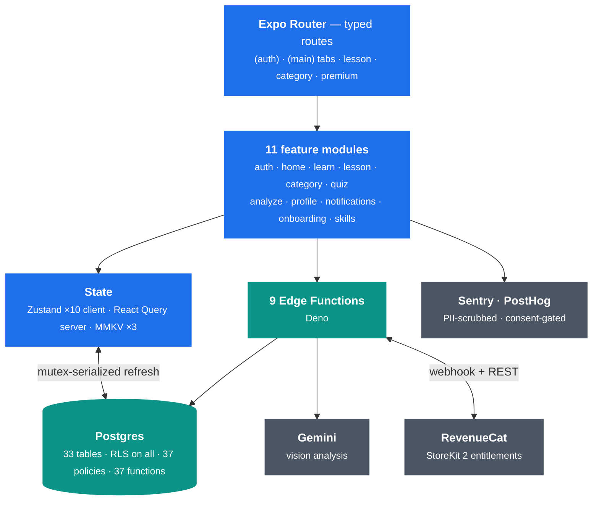
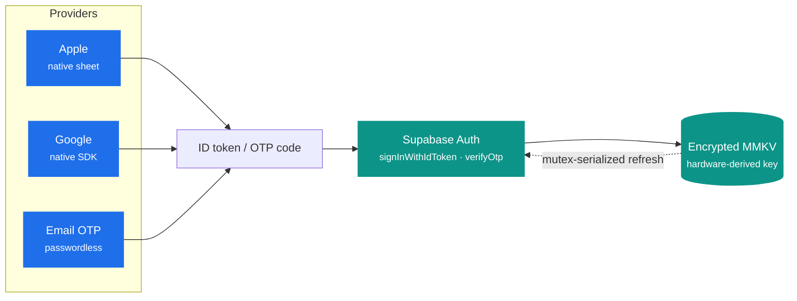
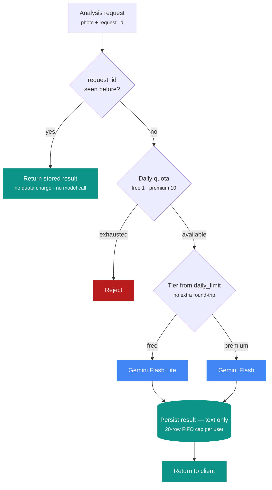
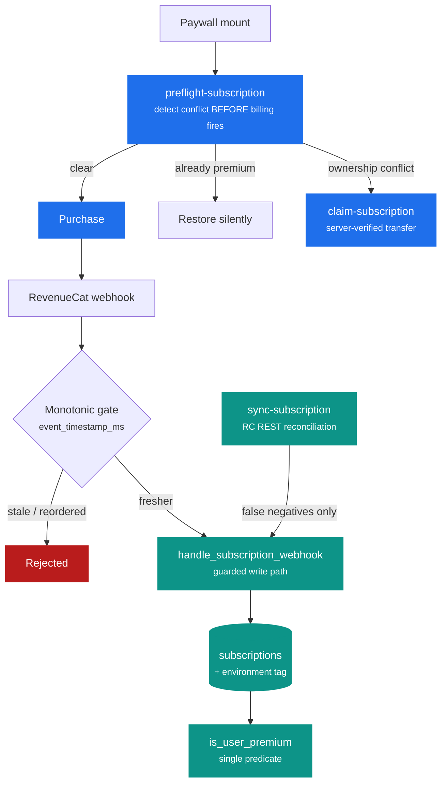

<div align="center">

# Bodica

**A production body language learning app, shipping on iOS and Android.**

Built end-to-end as a solo project — Postgres schema and Edge Functions, native auth flows, AI photo analysis, subscriptions, and a privacy-first telemetry pipeline.

[](https://reactnative.dev/)
[](https://expo.dev/)
[](https://www.typescriptlang.org/)
[](https://supabase.com/)
[](https://ai.google.dev/)
[](https://www.revenuecat.com/)
[](#)
[](#)

[**App Store**](https://apps.apple.com/app/id6756843038) · [**Google Play**](https://play.google.com/store/apps/details?id=com.anilburcu.readbody) · [Contact](#contact)

</div>

---

## Overview

Bodica teaches people to read nonverbal communication through structured lessons, interactive quizzes, and AI photo analysis. It ships in Turkish and English with a premium tier, and it's live on both stores.

The codebase is a feature-first React Native app on Hermes with the New Architecture enabled. State splits across three layers — Zustand for client state, TanStack Query for server state, encrypted MMKV for persistence — over a Supabase backend handling Postgres, Auth, and Deno Edge Functions. Every cross-cutting concern (auth, storage, telemetry, networking, error handling, billing) is treated as a first-class problem with an explicit solution.

This README is a tour of the engineering decisions, not a feature list.

## At a Glance

|                  |                                                                                  |
| ---------------- | -------------------------------------------------------------------------------- |
| **Platforms**    | iOS and Android — one TypeScript codebase, Hermes, New Architecture              |
| **Stores**       | Live on the App Store and Google Play, currently at 1.7.6                       |
| **App code**     | ~66K lines TypeScript, 11 feature modules, 112 test files                       |
| **Database**     | 33 tables with RLS enabled on every one, 37 policies, 37 Postgres functions      |
| **Serverless**   | 9 Deno Edge Functions — AI analysis, push, subscriptions, account deletion       |
| **Auth**         | Native Apple, native Google, email OTP — all token-based, no browser redirect    |
| **State**        | 10 Zustand stores, 38+ React Query hooks, 3 MMKV instances (1 hardware-encrypted)|
| **AI**           | Gemini vision, model tier selected by subscription, idempotent and quota-gated   |
| **Monetization** | RevenueCat on StoreKit 2, webhook-driven entitlements with a monotonic event gate|

## Architecture



### State — three layers, no overlap

| Layer | Tool | Responsibility |
| --- | --- | --- |
| **Client state** | Zustand, 10 stores | Auth session, UI state (toasts, banners), network status, GDPR consent, prompt queue, feature state (quiz progress, analysis flow). Persists to MMKV through a custom storage adapter. |
| **Server state** | TanStack Query, 38+ hooks | Fetching, caching (5 min stale, 10 min GC), mutations, retry that skips 401/403/404, automatic Sentry capture with sanitized query keys. |
| **Persistence** | MMKV, 3 instances | `secureStorage` — encrypted with a hardware-keychain-derived key, holds auth tokens. `appStorage` — preferences, onboarding, rate limits, notification config. `cacheStorage` — React Query persistence. |

Server state and client state never mix. React Query owns server data, Zustand owns UI state, and they communicate through hooks rather than a shared store. A `NetworkProvider` wires NetInfo into React Query's online manager, so queries pause offline and refetch on reconnect.

## Engineering Highlights

### Hardware-backed encrypted token storage

Auth tokens live in an encrypted MMKV instance whose key is generated with `crypto.getRandomValues`, persisted to the iOS/Android hardware keychain via `expo-secure-store`, and loaded asynchronously before any auth call. The key never leaves the secure enclave; tokens are encrypted at rest. A custom `StateStorage` adapter wires this into Supabase's auth persistence.

### Mutex-serialized token refresh

Concurrent requests can race the same Supabase refresh, producing duplicate refreshes and torn sessions. Refresh is serialized with `async-mutex` behind a custom `processLock` that:

- Races acquisition against a configurable timeout, so nothing blocks indefinitely
- Drains queued acquires after a timeout to prevent mutex leaks
- Mirrors GoTrue's `ProcessLockAcquireTimeoutError` shape, including the `isAcquireTimeout` flag, so Supabase's internal filtering still works
- Bounds the underlying network call with a 20-second `fetchWithTimeout`

### A WebCrypto polyfill that works around a Hermes crash

Hermes ships without WebCrypto, but Supabase auth needs `crypto.subtle.digest` (Apple nonce SHA-256, internal request IDs) and `crypto.getRandomValues`. Both are polyfilled at module load using `expo-crypto`.

The `digest` polyfill also serializes calls behind a mutex — concurrent native digests in Hermes can SIGSEGV inside `JavaScriptTypedArray::~JavaScriptTypedArray` due to a TypedArray allocation race. Serializing costs nothing at this call volume and turns an intermittent native crash into a non-event.

### Token-based auth across three providers



All three flows skip the browser entirely — no redirect, no deep-link parsing, no PKCE state machine for the user to get stranded in.

- **Apple** — native sheet via `expo-apple-authentication`; the identity token goes straight to `signInWithIdToken`. Cancellation is detected by error code (`ERR_REQUEST_CANCELED`), not string matching.
- **Google** — the native Sign-In SDK returns the ID token directly. Supabase's "skip nonce check" is required because the free SDK doesn't expose a nonce parameter.
- **Email OTP** — `signInWithOtp` + `verifyOtp`. No magic links to parse, no password to manage; cooldown and expiry timers survive navigation.

Login attempts and lockout timestamps persist to MMKV, so brute-force resistance survives a force-close.

### AI analysis — idempotent, tiered, and quota-gated

Photo analysis is the app's most expensive operation, so it's also the most defended.



The design decisions behind that flow:

- **Keys and prompts never reach the client.** The model call, the system instruction, and the response schema all live in the Edge Function.
- **Retries are free.** Each request is keyed on `(user_id, request_id)`. If the app is backgrounded mid-request or the network drops the response, the retry returns the stored result without re-charging quota or re-calling the model. A lost HTTP response no longer destroys a result the user already paid for.
- **Tier costs nothing to determine.** Free users get the cost-efficient lite model, premium users get the flagship. Rather than a second database round-trip, the tier is inferred from the quota RPC's `daily_limit` (1 for free, 10 for premium) — reusing the exact `is_user_premium()` predicate the quota system already trusts.
- **Results sync, photos don't.** The server stores analysis text only, capped at 20 rows per user with FIFO eviction — roughly 50 KB per user, bounded and cheap. History survives reinstall and device switches; the photos stay on-device, and the UI renders synced records without thumbnails.
- **Model choice is a zero-deploy change.** Both tier defaults and the thinking level are environment overrides, so an emergency rollback or an A/B test doesn't need a redeploy.

### Subscription integrity

This is where most of the hardening work went, because it's where the money is. RevenueCat with StoreKit 2 drives the lifecycle, but the server never trusts the client about entitlement.



**Preflight before billing.** The paywall calls `preflight-subscription` on mount, before Apple or Google billing is ever triggered, and decides what the Subscribe button should actually do — purchase, restore silently, or route into a claim flow. Discovering an ownership conflict *after* charging someone is a support ticket; discovering it before is a UI state.

**Transfers require server-side evidence.** An earlier version of `claim-subscription` trusted a client-declared attestation blob — anyone who knew a victim's `original_transaction_id` could POST `{is_active: true}` and steal their subscription. Client claims now authorize nothing. A transfer requires either a conflict state written by the authenticated RevenueCat webhook itself, or proof fetched server-side from the RevenueCat REST API with a secret key.

**Late webhooks can't clobber fresh state.** RevenueCat retries and can deliver out of order. A monotonic gate stores `last_event_timestamp_ms` on the subscription row and rejects any event whose timestamp isn't newer. It complements rather than replaces the older status-based expiration guard: that one only covers late `EXPIRATION` events, the monotonic gate covers every event type.

**Reconciliation only repairs false negatives.** When the client sees "RevenueCat says premium, the database says free", `sync-subscription` reads the subscription from RevenueCat's REST API with a server-only key and replays it through the *same* guarded webhook RPC — inventing no new write path, keeping every existing guard live. By construction it can only restore entitlement that RevenueCat confirms; it can never manufacture premium. Revocation stays the job of the webhook and the hourly expiry sweeper.

**Test money is labelled.** A TestFlight subscription renewing daily is indistinguishable from a paying customer in admin queries — until you tag it. Every webhook event and subscription row now carries its RevenueCat environment (`SANDBOX` or `PRODUCTION`). The tagging is deliberately additive: it's written by two service-role updates *after* the money-critical RPC commits, and failing to write it is non-fatal, because it's observability metadata and not entitlement state.

**Entitlements are email-locked.** Only the email address that originally purchased a subscription can use or restore it. No Apple-ID-level cross-transfer.

### Push notifications, end to end

A seven-step registration flow handles device validation, Android channel setup (gated behind an MMKV flag so it runs once), permission inspection without auto-prompting, EAS project ID validation, Expo token acquisition, server registration with mutex locking and exponential backoff, and iOS actionable category registration.

The runtime layer adds:

- **Smart foreground suppression** — banner, sound, and badge are suppressed when the active screen already shows the notification's target.
- **Token refresh throttling** — a dual cooldown check (in-memory and MMKV) plus mutex serialization prevents stampedes.
- **Background handler** for off-foreground processing, plus a **daily reminder scheduler** with randomized copy.
- **Token deactivation on logout**, with a device ID fallback.
- **Receipt verification** through a dedicated Edge Function, so silent delivery failures surface.

One Android-specific trap worth recording: R8 minification strips the reflectively-instantiated `TaskConsumer` constructors in `expo-notifications` and `expo-task-manager`, which breaks background remote notifications. Both libraries ship `proguard-rules.pro` files but never wire them through `consumerProguardFiles`, so the rules never reach the app's R8 step. The build config injects them explicitly.

### Sentry PII scrubbing

A `beforeSend` hook intercepts every event before transmission and filters sensitive headers (`authorization`, `apikey`, `x-supabase-auth`, `x-rc-api-key`), scrubs breadcrumb data containing tokens, secrets, or passwords, and sanitizes URL query parameters that could carry access tokens.

Initialization is production-only, with an `ErrorBoundary` providing a user-facing fallback offering retry and home navigation. React Query errors forward automatically, with query keys sanitized before capture.

### Consent-gated analytics

PostHog initializes lazily and only after explicit GDPR consent. Autocapture is fully disabled — events go through a wrapper that queues up to 50 while PostHog is uninitialized and flushes once it's ready. EU-hosted by configuration. Withdrawal flushes pending events and opts the user out cleanly.

### Force and soft update gate

On launch the client queries an `app_version` table and chooses between a blocking force update and a dismissible soft update by comparing against the running version. Update copy is localized in both languages.

## Backend

| Edge Function | Purpose |
| --- | --- |
| `analyze-body-language` | Gemini vision analysis, tier-aware, idempotent, quota-gated |
| `preflight-subscription` | Conflict detection before billing is triggered |
| `claim-subscription` | Server-verified entitlement transfer |
| `sync-subscription` | RevenueCat REST reconciliation, false negatives only |
| `verify-subscription` | Server-side entitlement check |
| `revenueCat-webhook` | Subscription event ingestion behind the monotonic gate |
| `push-notifications` | Server-side push delivery |
| `check-push-receipts` | Delivery receipt verification |
| `delete-account` | GDPR account and data removal |

## Project Structure

```
src/
├── app/                  Expo Router file-based routes
│   ├── (auth)/           Welcome, login, OTP verification
│   └── (main)/           Tabs (home, learn, analyze, quiz, profile),
│                         lesson, category, premium, notifications, settings
│
├── features/             Domain modules — components, hooks, api, stores, types
│   ├── analyze/          AI photo analysis with history
│   ├── auth/             Apple, Google, email OTP flows
│   ├── category/         Category browsing
│   ├── home/             Home screen, daily challenges, continue learning
│   ├── learn/            Content library, search
│   ├── lesson/           Lesson player, completion, saved lessons
│   ├── notifications/    Inbox, preferences
│   ├── onboarding/       First-run flow
│   ├── profile/          Profile, premium modal, badges, XP, settings
│   ├── quiz/             Quiz sessions, scoring, difficulty
│   └── skills/           Skill tracking and progress
│
├── components/           Shared UI — ui/, feedback/, layout/, navigation/, skeletons/, icons/
├── hooks/                Cross-cutting hooks (notifications, haptics, network, lifecycle, theme)
├── lib/                  Core setup — supabase, sentry, posthog, queryClient, storage, guards
├── services/             Analytics, RevenueCat, notifications, subscriptions, updates
├── stores/               Global Zustand stores
├── providers/            React context providers (QueryClient, Network)
├── constants/            App config, query keys, design constants
├── theme/                Theme tokens
├── i18n/                 Translations (en.json, tr.json)
├── types/                TypeScript types and generated Supabase schema
├── utils/                Logger, version helpers, i18n helpers, store reset
└── test-utils/           Jest setup and shared mocks
```

Every feature module has the same shape — predictable, navigable, isolated:

```
features/<module>/
├── api/          Supabase queries and mutations
├── components/   Feature-specific React components
├── hooks/        React Query hooks and feature logic
├── stores/       Zustand stores (when local state is needed)
├── types/        TypeScript types
└── utils/        Pure helpers
```

## Privacy & Security

- **Row Level Security on all 33 tables** — data ownership is enforced in the database, not the client.
- **Encrypted token storage** — hardware-keychain-derived MMKV key, initialized before auth runs.
- **GDPR consent gating** — analytics stay dark until explicit opt-in; opt-out flushes and shuts down cleanly.
- **PII scrubbing** — Sentry events sanitized before transmission (headers, breadcrumbs, query params).
- **Server-side secrets** — model keys, prompts, and the RevenueCat REST key exist only in Edge Functions.
- **Account deletion** — a dedicated Edge Function performs full account and data removal.
- **Apple Privacy Manifest** — declared API usage reasons plus declared collection of purchase history, crash, and performance data. Tracking explicitly disabled.

## Quality & Tooling

- **Tests** — 112 test files across hooks, services, lib utilities, and feature flows, plus a Supabase integration suite that runs serially against a real schema. The billing paths are tested adversarially, against fraud vectors rather than only happy paths.
- **Static analysis** — TypeScript strict mode, ESLint 9 with the Expo config, `expo-doctor` in the pre-production gate.
- **Pre-commit** — Husky and lint-staged run ESLint on changed `.ts/.tsx` only.
- **Schema typing** — Supabase types are generated and committed, so database changes fail at compile time.
- **Pre-production check** — one `npm run pre-production` runs `depcheck`, `npm audit`, `npm dedupe`, `expo install --fix`, and `expo-doctor` before a release build.
- **OTA updates** — `expo-updates` on an `appVersion` runtime policy; native binaries change only when they must.

## Engineering Decisions Worth Calling Out

- **Feature-first, not layer-first.** Modules own their components, hooks, API, stores, and types. Cross-cutting concerns live in `lib/`, `services/`, and `hooks/`.
- **Three storage instances, not one.** Encryption has a real cost, so only auth tokens pay it. Preferences and the React Query cache use unencrypted MMKV.
- **The client is never the authority on money.** Entitlement is one server predicate. Every write path into it is guarded, ordered, and replay-safe.
- **Idempotency before retry.** The analysis endpoint was designed to be replay-safe from the start, which is what makes an aggressive client retry policy affordable.
- **Privacy is a build-time decision.** Sentry scrubbing lives in `beforeSend`, PostHog init is gated on a consent flag, and the Apple Privacy Manifest is generated from `app.config.ts`.

## Contact

This is a showcase repository — the source is private.

For collaboration, employment, or technical questions: [anl@icodex.dev](mailto:anl@icodex.dev) · [icodex.dev](https://icodex.dev) · [LinkedIn](https://www.linkedin.com/in/anil-burcu/)
